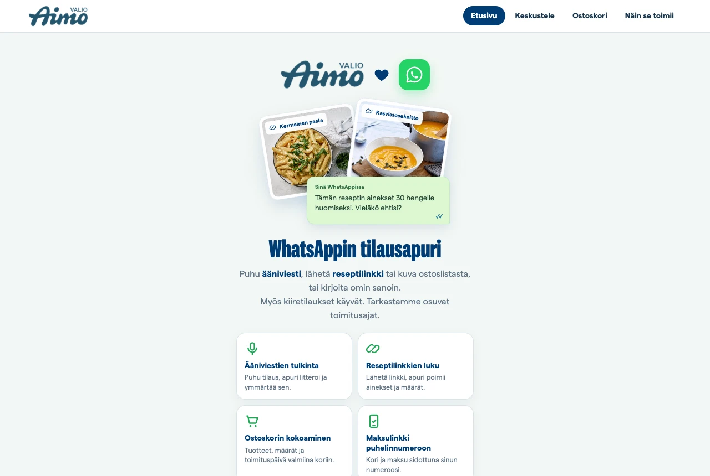
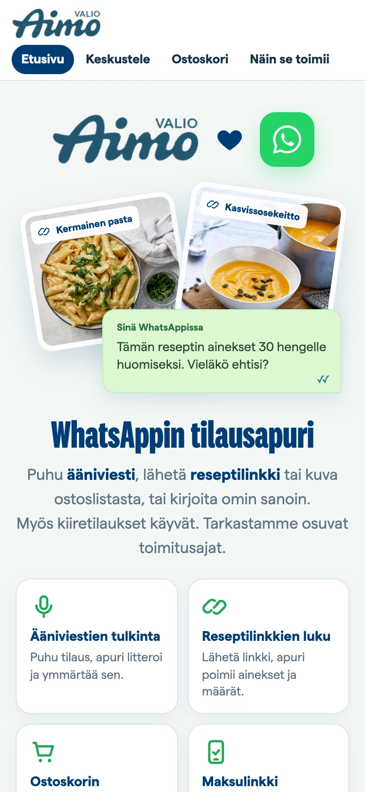
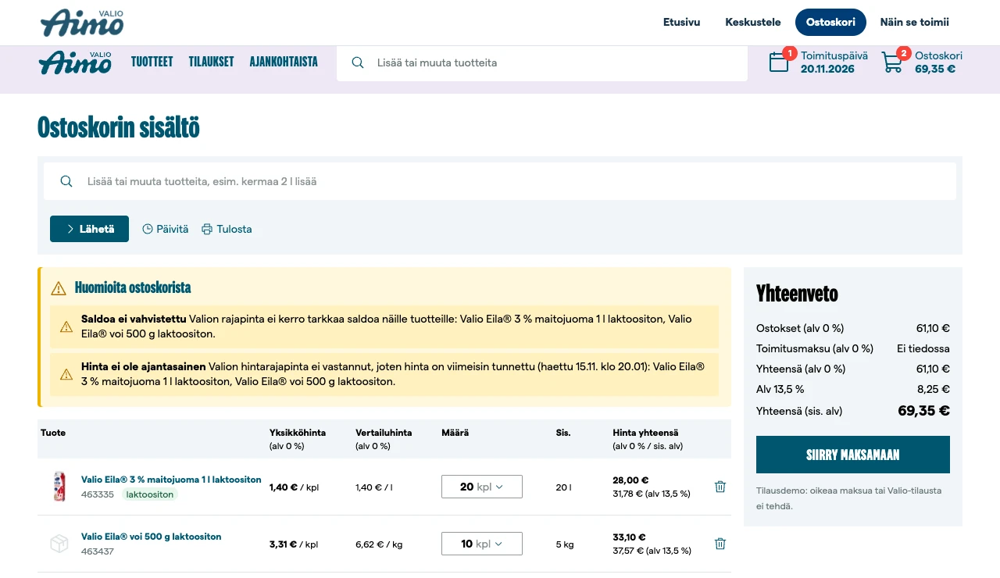
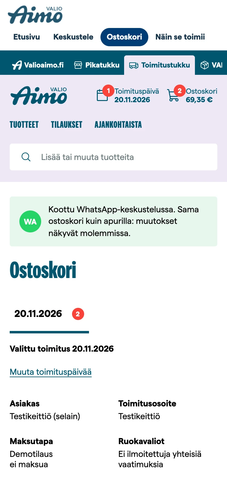
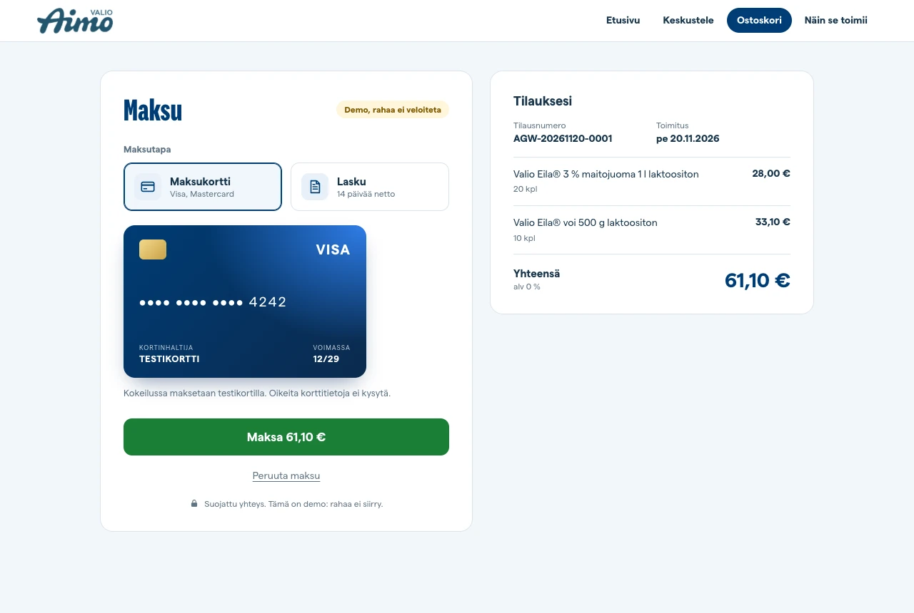
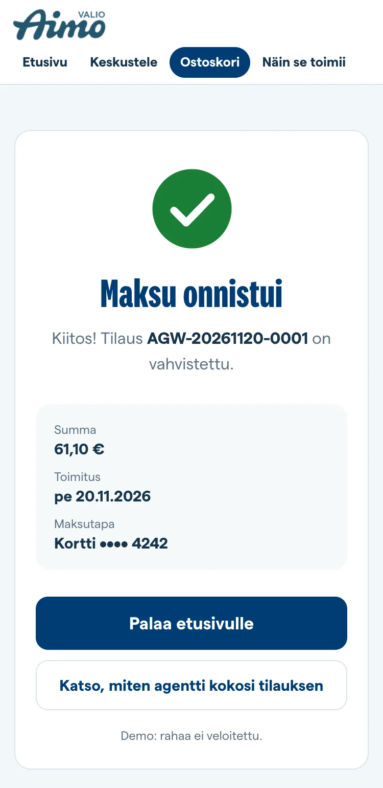
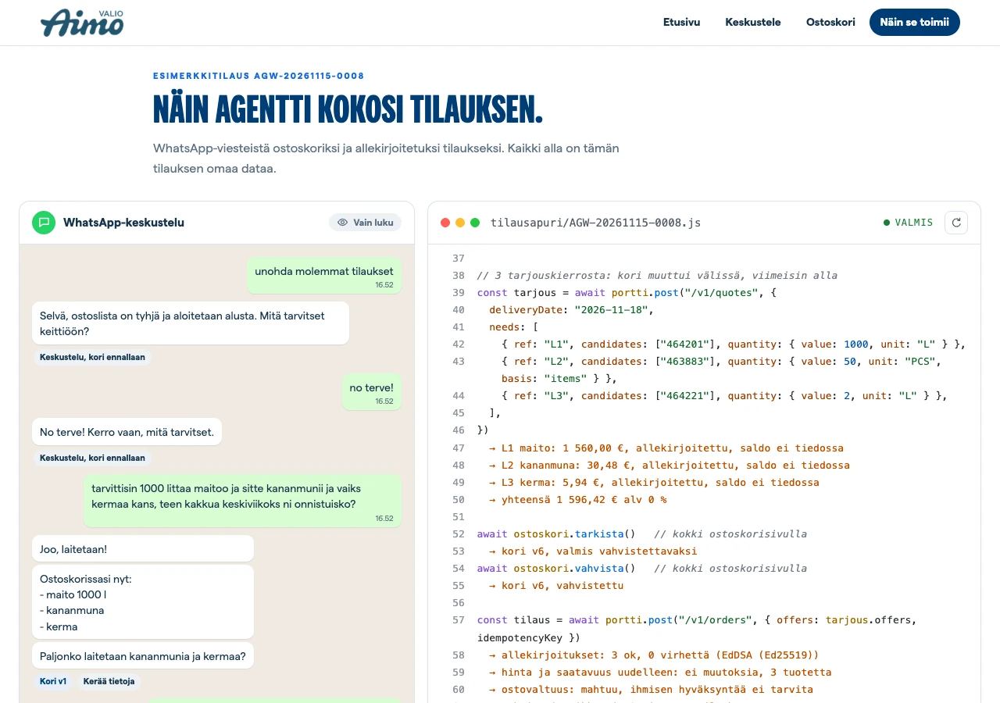
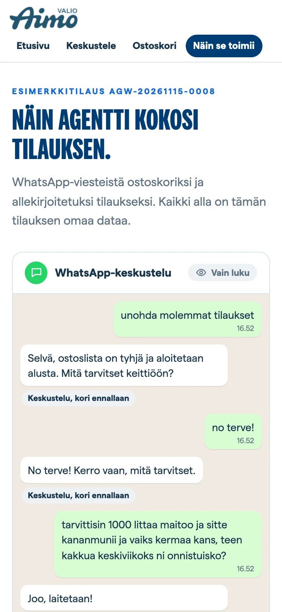
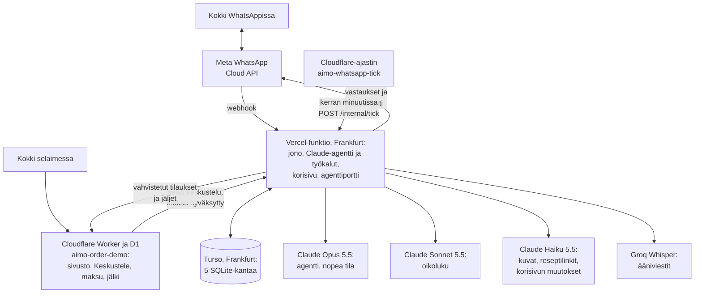

# Valio Aimo -tilausapuri

[](https://github.com/eeputti/valioaimo-tilausapuri/actions/workflows/test.yml)

**Ammattikeittiö tilaa Valio Aimon tuotteet WhatsAppissa kuin myyjältä: kirjoittamalla, ääniviestillä, kuvalla tai reseptilinkillä.** Claude-agentti selvittää toimituspäivän, allergiat ja erityisruokavaliot, tuotteet ja määrät ja lähettää sitten linkin ostoskoriin. Kokki tarkistaa korin Valio Aimon verkkokaupan näköisellä sivulla ja vahvistaa tilauksen itse. Tilaus kulkee agenttiportin läpi: hinnat lukitaan allekirjoitettuun tarjoukseen, ostajan valtuudet tarkistetaan koodilla ja jokainen päätös jää lokiin. Demomaksun jälkeen tilausvahvistus tulee WhatsAppiin.

**Kokeile selaimessa:** [aimo-order-demo.aimo-demo-41cfac.workers.dev](https://aimo-order-demo.aimo-demo-41cfac.workers.dev). Keskustele-välilehdellä puhut saman agentin kanssa kuin WhatsAppissa, mutta vain kirjoittamalla.

<p align="center">
  
  
</p>

## Mitä apuri osaa

- **Puhekieli ja kirjoitusvirheet:** "20 l laktoositonta maitoo perjantaiks", "pottu", "räätikäsloora".
- **Ääniviestit:** puhe litteroidaan tekstiksi, ja agentti käsittelee sen kuten kirjoitetun viestin.
- **Kuvat:** ostoslistasta, lähetteestä tai hyllystä luetaan tuoterivit ja määrät.
- **Reseptilinkit:** sivulta luetaan ainekset ja annosmäärä, ja agentti laskee määrät oikealle henkilömäärälle.
- **Monta viestiä peräkkäin:** apuri odottaa hetken ja vastaa kaikkiin kerralla (6 s viimeisestä viestistä, enintään 20 s).
- **Tuotevalinta:** agentti valitsee käyttöön sopivimman tuotteen ja pakkauksen, josta jää vähiten hävikkiä, ja kertoo, että minkä tahansa voi vaihtaa. Laktoositonta, gluteenitonta tai muuta erityistuotetta se valitsee vain, kun kokki on kertonut tarpeen.
- **"Sama kuin viimeksi":** ostajan aiemmat tilaukset uusilla hinnoilla.

Tuotteet, hinnat, saatavuus ja allergeenit tulevat vain Valion datasta ja agenttiportista. Agentti ei saa keksiä tuotteita, hintoja eikä linkkejä, ja koodi tarkistaa jokaisen vastauksen euromäärät työkalujen tiedoista ennen lähetystä. Tilauksen tekee aina kokki itse korisivulla.

## Tilauksen kulku

1. **Viesti WhatsAppiin.** Metan webhook kuitataan heti, ja viesti menee jonoon. Ääniviesti litteroidaan, kuva ja reseptilinkki luetaan tekstiksi.
2. **Agentti keskustelee.** Agentilla on tarkistuslista: toimituspäivä, allergiat ja erityisruokavaliot, tuotteet, määrät ja lopuksi ostoskori. Järjestys on vapaa. Se kysyy yhden asian kerrallaan ja hoitaa kaiken omilla työkaluillaan.
3. **Korilinkki.** Kun lista on valmis, kokki saa WhatsAppiin korin tuotteet hintoineen ja **Avaa ostoskori** -painikkeen. Linkki on allekirjoitettu, sidottu kokin numeroon ja tähän koriin, ja se on voimassa vuorokauden.
4. **Ostoskori.** Kori näyttää Valio Aimon verkkokaupan korilta ja käyttää samaa luonnosta kuin keskustelu. Muutokset kirjoitetaan korin tekstikenttään ("kermaa 2 l lisää"), ja määrän painike täyttää kentän valmiiksi.
5. **Siirry maksamaan.** Agenttiportti tekee tuoreen, allekirjoitetun tarjouksen ja vahvistaa tilauksen samalla: hinta ja saatavuus tarkistetaan uudelleen, ostajan valtuudet (tilaus- ja päiväkatto, ruokavalio, allergeenit) tarkistetaan, ja kaksoistilaukset estetään.
6. **Demomaksu.** Maksusivu näyttää tilauksen, toimituspäivän ja summan. Maksutapana on testikortti tai lasku. Rahaa ei siirry, eikä oikeita korttitietoja kysytä.
7. **Vahvistus WhatsAppiin.** Hyväksytyn maksun jälkeen kokki saa WhatsAppiin kiitosviestin, jossa ovat tilausnumero ja toimituspäivä. Sähköpostia ei lähetetä.
8. **Näin agentti kokosi tilauksen.** Tilauksen omalla linkillä aukeaa sen jälki: keskustelu sekä agentin ja agenttiportin vaiheet koodina. Puhelinnumerot, nimet ja linkit peitetään.

<p align="center">
  
  
</p>
<p align="center">
  
  
</p>
<p align="center">
  
  
</p>

## Arkkitehtuuri



| Osa | Missä | Tehtävä |
|---|---|---|
| Botti | Vercel-funktio `api/index.mjs` → `server/cloud.mjs`, Frankfurt | Webhook kuitataan heti, ja jono käsitellään samassa kutsussa (`waitUntil`). Enintään 8 asiakasta rinnakkain instanssia kohden, saman numeron viestit järjestyksessä. |
| Agentti | `server/agent/` | Claude-silmukka 13 työkalulla (`tools.mjs`): toimituspäivä, ruokavalio, tuotehaku ja tuotetiedot, korin rivit, aiemmat tilaukset, uusi tilaus, korilinkki, linkin luku ja palaute. Vastauksen euromäärät tarkistetaan työkalujen datasta (`guard.mjs`), ja valmis vastaus oikoluetaan (`proofread.mjs`). Tuotannossa Opus 5.5, effort high, nopea tila. |
| Tuotehaku | `server/storefront.mjs`, `server/aimo/`, `server/order-tools/` | Puhekielen tuotesanat, synonyymit, pakkausmäärät ja allergeenit Valion tuotedatasta (17 546 tuotetta). Vain valitulle päivälle tilattavat tuotteet. |
| Tilausydin ja korisivu | `server/order-conversation/`, `server/whatsapp/cart-link.mjs`, `storefront-cart.mjs` | Sama luonnos keskustelussa ja korissa. Korisivun tekstimuutokset tulkitaan Haiku 5.5:llä ja säännöillä, ja tilauksen vahvistus kulkee tilausytimen kautta. |
| Agenttiportti | `server/gateway/` | Ed25519-allekirjoitetut tarjoukset, tuore hinta- ja saatavuustarkistus, ostajan mandaatti, ihmisen hyväksyntä, idempotenssi ja hash-ketjutettu päätösloki. |
| Hinnat | `server/valioApi.mjs` | Haasteen testirajapinta on suljettu, joten käytössä ovat viimeisimmät Valiolta saadut oikeat hinnat ja saatavuudet noin 900 tuotteelle. Hintaa ei arvioida: ilman hintaa apuri kertoo sen ja ehdottaa korvaajaa. |
| Kannat | Turso, Frankfurt | Viisi SQLite-kantaa: viestijono ja jäsenet, luonnokset ja agentin keskustelut, tarjoukset, agenttiportin tilaukset ja loki sekä hintavälimuisti. `server/sqlite.mjs` avaa `libsql://`-osoitteen samalla rajapinnalla kuin paikallisen tiedoston. |
| Ääniviestit | Groq, `whisper-large-v3-turbo` | Litterointi suomeksi (`WHATSAPP_TRANSCRIBE=groq`). |
| Sivusto | Cloudflare Worker `aimo-order-demo` ja D1 (`deploy/cloudflare/`) | Etusivu, Keskustele, ostoskorin välitys, Näin se toimii, demomaksu, omat tilaukset ja agentin jälki. Hyväksytty maksu pyytää bottia lähettämään kiitosviestin. |
| Ajastin | Cloudflare Worker `aimo-whatsapp-tick` (`deploy/vercel/tick/`) | Kerran minuutissa: keskeytyneet käsittelyt takaisin jonoon, lähetysten uusinta, tilausten ja jälkien välitys Workeriin ja siivous. |

Selainkeskustelu ja WhatsApp käyttävät samaa bottia ja samoja kantoja. Worker välittää selaimen viestit botille jaetulla salaisuudella (`WEBCHAT_SECRET`), ja jokainen selain saa oman keksityn testiasiakkaan. Puhelimella Keskustele-sivu ei ole käytössä, koska puhelimella jutellaan oikeassa WhatsAppissa.

## Kansiot

| Kansio | Sisältö |
|---|---|
| `server/agent/` | Claude-agentti: silmukka, ohje, työkalut, hintavartija, oikoluku ja keskusteluhistoria |
| `server/whatsapp/` | Meta-kanava, jono ja viestien niputus, numeroliitos, korilinkki ja korisivu, kuvat (`media.mjs`), ääniviestit (`transcribe.mjs`), linkit (`link-*.mjs`), selainkeskustelu (`web-chat.mjs`), maksu (`checkout.mjs`) ja kiitosviesti (`order-paid.mjs`) |
| `server/order-conversation/` | Tilausluonnos, toimituspäivä, korisivun muutosten tulkinta ja vahvistus |
| `server/order-tools/` | Tuotevaihtoehdot ja niiden syyt, tarjoukset ja vahvistus |
| `server/aimo/`, `server/storefront.mjs`, `server/valioApi.mjs`, `server/allergens.mjs` | Tuotehaku puhekielestä, pakkausmäärät, allergeenit, hinta ja saatavuus |
| `server/gateway/` | Agenttiportti: tarjoukset, tilaukset, mandaatit, allekirjoitukset ja päätösloki |
| `server/cloud.mjs`, `server/sqlite.mjs`, `api/` | Pilviajo Vercelissä ja Turso-kannat |
| `public/` | Korisivu, maksun käynnistys, paikallinen selainkokeilu ja hyväksyntänäkymä |
| `deploy/cloudflare/` | Demosivusto Workerina: sivut, D1-skeema, tilausten julkaisija ja Workerin testit |
| `deploy/vercel/` | Kantojen siirto Tursoon, asetusten vienti Verceliin ja minuuttiajastin |
| `test/`, `eval/`, `scripts/` | Testit, arvioinnit ja ylläpitotyökalut |
| `docs/` | Ohjeet ja raportit, `docs/kuvat/` README:n kuville |

## Ajo paikallisesti

Node.js 22.13 tai uudempi.

```bash
npm ci
cp .env.example .env
npm run whatsapp
```

Tuotekatalogi (`data/catalog.json`) tehdään haasteen lähdeaineistosta komennoilla `npm run fetch-data` ja `npm run catalog`. Aineiston käyttö on rajattu haasteeseen, joten aineistoa, katalogia, kantoja ja avaimia ei tallenneta GitHubiin. Meta-asetukset ja kantapolut ovat [WhatsApp-ohjeessa](docs/whatsapp.md).

| Asetus | Vaikutus |
|---|---|
| `WHATSAPP_ORDERING_ENABLED=true` | Tilauspolku käyttöön; ilman sitä botti kertoo vain, ettei tilaaminen ole käytössä |
| `ANTHROPIC_API_KEY` | Kielimallit käyttöön; ilman sitä viestit tulkitaan säännöillä |
| `WHATSAPP_AGENT=v2` | Claude-agentti vastaa WhatsAppissa ja selainkeskustelussa (tuotannossa päällä). Ilman sitä vastaa vanhempi sääntöihin ja Haikuun perustuva putki. |
| `WHATSAPP_AGENT_MODEL`, `WHATSAPP_AGENT_EFFORT`, `WHATSAPP_AGENT_SPEED` | Agentin malli, effort ja nopea tila. Koodin oletus on Sonnet 5.5 medium; tuotannossa `claude-opus-5-5`, `high` ja `fast`. |
| `DEEP_MODEL`, `FAST_MODEL` | Kuvien, linkkien ja korisivun muutosten malli (tuotannossa molemmat `claude-haiku-5-5`) |
| `VALIO_FALLBACK=last-known`, `FALLBACK_PRICE_MAX_AGE_HOURS=none` | Viimeisimmät tunnetut Valion hinnat ilman ikärajaa (tuotannossa näin) |
| `WHATSAPP_TRANSCRIBE=groq`, `GROQ_API_KEY` | Ääniviestit käyttöön |

Paikallisen palvelimen osoitteet:

| Osoite | Käyttö |
|---|---|
| `/webhooks/whatsapp` | Metan allekirjoitettu webhook |
| `/whatsapp/cart#…` | Yksityinen korilinkki |
| `/healthz` | Terveystarkistus; tilaustilassa `ordering-demo` |
| `/demo` | Sama keskustelu selaimessa omalla testiasiakkaalla, vain palvelinkoneelta |

`npm start` käynnistää paikallisen kaupan ja agenttiportin rajapinnat (`/v1/quotes`, `/v1/orders`, `/mcp`, `/openapi.json`, sopimus `server/gateway/contract.mjs`). Pilvessä nämä reitit eivät näy ulos.

Korisivu käyttää Valio Aimon kaupallisia Matter- ja National 2 -fontteja, joita ei jaeta tässä repossa. Kopioi ne paikallisesti kansioihin `public/storefront-assets/` ja `deploy/cloudflare/public/fonts/`; ilman niitä sivut käyttävät järjestelmän fonttia.

## Testit

```bash
npm test
npm --prefix deploy/cloudflare test
npm run aimo:eval
npm run aimo:eval:spoken
```

Testit käyttävät omia tilapäisiä kantoja ja simuloituja ulkoisia palveluita, eivätkä ne kutsu Metaa, Valiota tai kielimallia. Katalogia tarvitsevat testit ohitetaan, jos `data/catalog.json` puuttuu, joten GitHub Actions ajaa kaiken muun jokaisesta pushista. Agentin arviointi oikealla mallilla (`scripts/agent-v2-eval.mjs`) ja keskusteluarvioinnit (`scripts/whatsapp-*`) kuluttavat mallikrediittejä, ja ne ajetaan käsin.

## Rajat

- **Metan testinumero:** WhatsAppissa apurille voi viestiä vain numero, jonka ylläpitäjä on lisännyt Metan testivastaanottajaksi ja yhdistänyt testiasiakkaaksi ([ohje](docs/demo-onboarding.md)). Kaikille avoin käyttö vaatii oman yritysnumeron. Selainkeskustelu toimii kaikille.
- **Demotilaukset:** tilaukset ja maksut ovat demoja. Oikeaa Valio-tilausta, maksua tai toimitusta ei tehdä.
- **Kiitosviesti:** Meta ottaa vapaan viestin vastaan vain 24 tunnin sisällä asiakkaan viimeisestä viestistä, joten myöhemmin maksettu tilaus jää ilman WhatsApp-vahvistusta. Selainkeskustelun asiakas näkee vahvistuksen maksusivulla.
- **Valion oikeat rajapinnat puuttuvat:** hinnat ja saatavuus ovat suljetun testirajapinnan viimeisimpiä arvoja noin 900 tuotteelle. Tuotannossa asiakastunnistus, asiakaskohtaiset hinnat, tilausrajapinta ja ostovaltuudet tulisivat Valion järjestelmistä; tässä ne korvataan testiasiakkailla ja demomandaateilla.
- **Kielimalli voi erehtyä:** siksi hinnat, tilauksen sisällön ja hyväksynnän ratkaisee koodi, ja kokki tarkistaa korin aina itse ennen tilausta.

## Ohjeet

- [WhatsAppin asetukset](docs/whatsapp.md)
- [Demon testiasiakkaat](docs/demo-onboarding.md)
- [Pilvijulkaisu: Vercel ja Turso](docs/vercel.md)
- [Cloudflare-osuus](docs/cloudflare.md)
- [Selainkeskustelu](docs/web-chat.md)
- [Vahvistettu tilaus, demomaksu ja kiitosviesti](docs/order-events.md)
- [Agentin jälki](docs/agent-trace.md)
- [Claude-agentin suunnitelma](docs/agent-v2.md) ja [raportit](docs/agent-v2/)
- [Hakukerros](docs/aimo-malli.md)

## Kuvista

Etusivu, kori ja agentin jälki on kuvattu 17.11.2026 julkiselta demosivustolta 1280 ja 375 pikselin leveydellä. Kori on selainkeskustelun keksityltä testiasiakkaalta (Testikeittiö), eikä siitä tehty tilausta. Maksusivu on kuvattu samasta koodista paikallisesti keksityllä demotilauksella, koska maksulinkki on aina henkilökohtainen, ja maksun onnistumisnäkymä 20.11.2026. Agentin jälki on demon julkinen esimerkkitilaus 15.11.2026, jolloin vastaukset teki vielä vanhempi putki.

## Tausta

Tilausapuri sai alkunsa Junction 2026 -hackathonissa 13.–15.11.2026, jossa teimme tiimin kanssa Valion haasteeseen ensimmäisen prototyypin, aimo-ain. Sen jälkeen olen kehittänyt tilausapurin itse tässä repossa: Claude-agentin, pilviajon Vercelissä, WhatsApp-polun ääniviesteineen ja kuvineen sekä korisivun ja maksun.

## Tekijät

Eelis Puro ([eeputti](https://github.com/eeputti)).

Kaikki oikeudet pidätetään, ks. [LICENSE](LICENSE). Käyttöön tarjotaan vain Valiolle, ja käytöstä sovitaan erikseen Valion kanssa.
